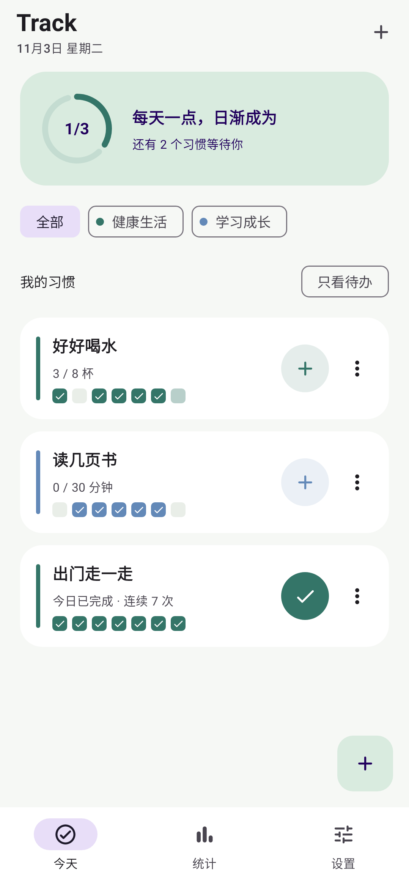
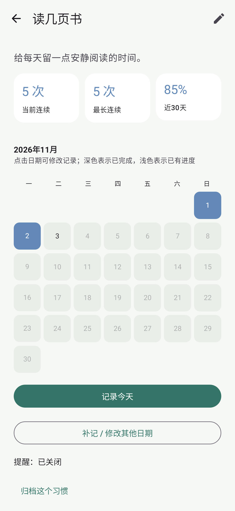
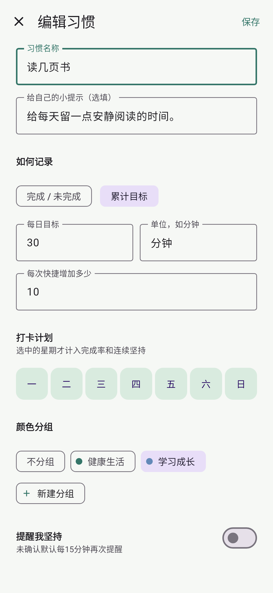
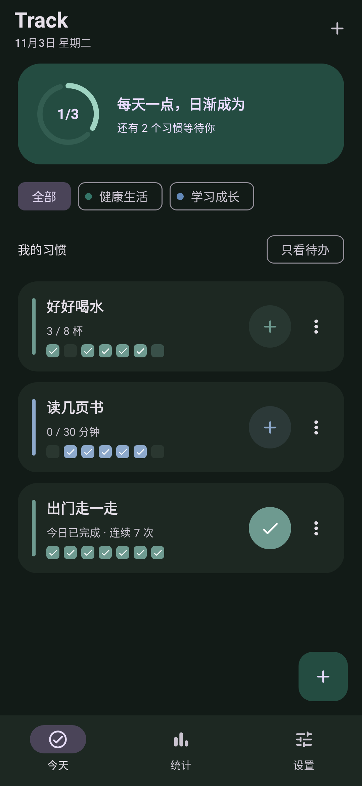

# Track

**每天一点，日渐成为。**

一款简洁、专注的 Android 习惯打卡应用。 
把想养成的习惯变成每天看得见、做得到的小行动。

[⬇️ 下载 APK](https://github.com/jelly2187/track-android/releases/latest) · [📖 使用指南](docs/USAGE.md) · [📝 更新记录](CHANGELOG.md)

---

## 🌱 让坚持有迹可循

每天读几页书、多喝几杯水、出门走一走……Track 帮你把这些小事安排好、记下来。

打开应用，今天要做什么、已经完成多少、最近坚持得怎么样，都能一眼看到。也可以把习惯放到手机桌面，随手完成一次打卡。

## 📱 看看 Track

<table>
  <tr>
    <th>今天，掌握每日进度</th>
    <th>记录，看见坚持轨迹</th>
    <th>计划，找到自己的节奏</th>
  </tr>
  <tr>
    <td></td>
    <td></td>
    <td></td>
  </tr>
</table>

🌙 也有适合夜晚的深色主题

截图来自应用实际页面，使用演示习惯数据。

## ✨ 为日常坚持准备的功能

### ✅ 一次打卡，或一点点累计

“今天有没有运动”可以一键确认；“喝水 8 杯”“阅读 30 分钟”可以逐次累计。支持自定义单位和快捷增量，也能补记、修改或撤销记录。

### 🔔 按你的节奏提醒

每天、指定星期、一天多个时间，都可以设置。打卡计划与提醒计划分别安排，未确认时可继续提醒；当天达标或确认未完成后停止，夜间可以静音。

### 🏡 习惯就在手机桌面

用习惯列表小组件查看今日状态、直接打卡或增加进度；用单项日历小组件看看近期记录与连续坚持次数。支持多个小组件，分别展示不同分组或习惯。

### 📅 每一份努力都看得见

近期打卡格、月历、完成率、当前连续与最长连续记录，帮你回看自己的节奏。计划内的休息日不会打断连续坚持。

### 🎨 把生活整理成喜欢的样子

用颜色区分健康、学习和生活习惯，通过分组快速筛选。浅色、深色与跟随系统三种外观，让日常记录清爽顺手。

### 🔒 记录留在自己手里

无需账号，没有广告。习惯和打卡记录保存在本机，日常打卡与统计离线可用，支持完整备份的导出与恢复。联网用于检查版本和下载安装包，不上传习惯记录。

## 🚀 从一个小习惯开始

1. **创建习惯**：为它取个名字，选择一键完成或累计目标。
2. **安排节奏**：选好打卡日，按需要添加提醒与颜色分组。
3. **每天行动**：在应用、通知或桌面小组件中记录，慢慢积累自己的轨迹。

| 想养成的习惯 | 可以这样设置 |
| --- | --- |
| 📚 每天读一点书 | 每天累计 30 分钟，每次增加 10 分钟 |
| 💧 记得喝水 | 每天 8 杯，在几个时间点提醒自己 |
| 🚶 保持活动 | 每周指定日打卡，完成后轻点一下 |

## ⬇️ 下载与更新

前往 [GitHub Releases](https://github.com/jelly2187/track-android/releases/latest) 下载最新版 APK，安装即可使用，支持 Android 8.0 及以上。

Track 会在启动时检查新版本，也可以在设置中手动检查。下载后确认系统安装即可覆盖升级，保留现有记录；首次可能需要允许 Track 安装应用。

> 使用旧版 0.1.0 / 0.1.1？请先从本仓库手动覆盖安装 0.1.2 或更新版本，**不要卸载旧版**。升级后会使用新的更新渠道。

提醒权限、桌面小组件、备份恢复等操作，见 [使用指南](docs/USAGE.md)。

## 💬 一起让 Track 更好用

遇到问题或有新的想法，欢迎通过 [Issues](https://github.com/jelly2187/track-android/issues) 分享。反馈时附上应用版本、问题发生的步骤与必要截图，会更容易定位。

Track 以 [MIT License](LICENSE) 开源。想参与开发？请查看 [开发与构建指南](docs/BUILD.md) 和 [第三方说明](THIRD_PARTY_NOTICES.md)。
